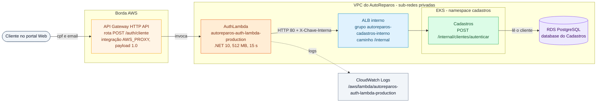
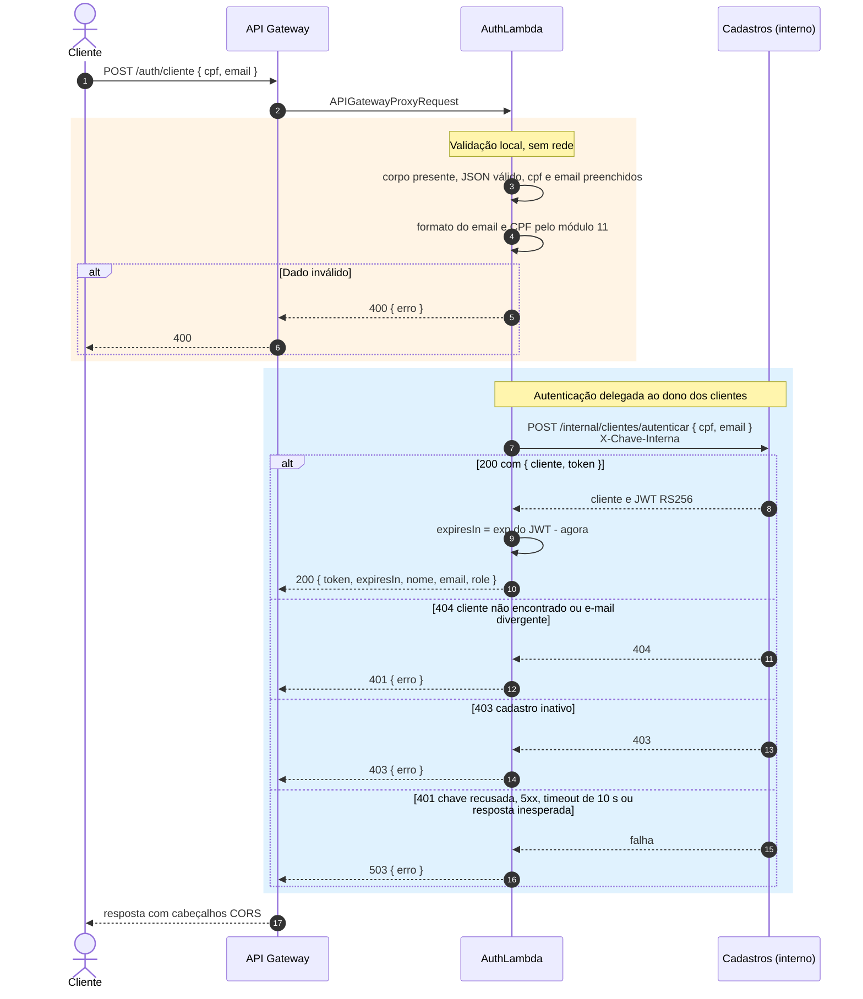
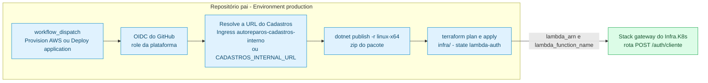

# AutoReparos.AuthLambda

> Function serverless que autentica o **cliente final** da oficina por CPF e e-mail e devolve o JWT emitido pelo serviço de Cadastros.

[](https://github.com/Grupo78-PosTech-15SOAT/AutoReparos.AuthLambda/actions/workflows/ci.yml)


| | |
|---|---|
| **Projeto** | AutoReparos — Sistema Integrado de Oficina Mecânica |
| **Fase** | Tech Challenge FIAP SOAT — Fase 4 (microsserviços, Saga e CI/CD), Grupo 78 |
| **Papel** | Autenticação do cliente na borda (`POST /auth/cliente` do API Gateway) |
| **Stack** | C# .NET 10, `Amazon.Lambda.*`, `HttpClient`, `System.IdentityModel.Tokens.Jwt`, Terraform (provider AWS `~> 6.27`) |
| **Repositório pai** | [Grupo78-PosTech-15SOAT/AutoReparos](https://github.com/Grupo78-PosTech-15SOAT/AutoReparos) |

---

## Sumário

1. [Visão geral e papel no ecossistema](#1-visão-geral-e-papel-no-ecossistema)
2. [Arquitetura](#2-arquitetura)
3. [Contrato HTTP](#3-contrato-http)
4. [Estrutura do repositório](#4-estrutura-do-repositório)
5. [Pré-requisitos](#5-pré-requisitos)
6. [Como rodar e testar localmente](#6-como-rodar-e-testar-localmente)
7. [Infraestrutura (Terraform)](#7-infraestrutura-terraform)
8. [CI/CD e deploy](#8-cicd-e-deploy)
9. [Variáveis e segredos](#9-variáveis-e-segredos)
10. [Segurança](#10-segurança)
11. [Repositórios relacionados](#11-repositórios-relacionados)

---

## 1. Visão geral e papel no ecossistema

O cliente da oficina não tem login e senha: ele se identifica com **CPF e e-mail** no portal. Esta Lambda recebe essa requisição pelo API Gateway, valida os dados e pede ao **Cadastros** (dono dos clientes) que autentique o cliente e emita o token.

O que a Lambda **faz**:

- valida o corpo, o formato do e-mail e o CPF (dígitos verificadores do módulo 11, rejeitando sequências repetidas como `111.111.111-11`);
- chama o endpoint interno `POST /internal/clientes/autenticar` do Cadastros, com o cabeçalho `X-Chave-Interna`;
- traduz a resposta do Cadastros em `200`, `401`, `403` ou `503` e calcula `expiresIn` a partir do `exp` do JWT recebido.

O que a Lambda **não faz** (Fase 4, decisões D-11 e D-30 da especificação):

- **não acessa banco de dados**: nenhum driver de banco é referenciado, e o security group do RDS não libera a Lambda. Isso atende à regra do enunciado de que *nenhum serviço acessa diretamente o banco de outro*;
- **não assina tokens nem guarda segredo de assinatura**: o JWT é emitido pelo Cadastros com chave assimétrica (RS256, com `kid`) e validado por OS, Cobrança e Execução pelo JWKS publicado pelo Cadastros.

> Na Fase 3 esta Lambda lia a tabela `Clientes` direto no PostgreSQL e assinava o próprio JWT. Na Fase 4 isso foi substituído pela chamada ao endpoint interno do Cadastros (commit `eec88a8`).

---

## 2. Arquitetura

### 2.1 Visão de componentes



O ALB interno do grupo `autoreparos-cadastros-interno` é criado pelo chart do Cadastros e é separado do ALB que o API Gateway alcança: a rota `/internal` não é publicada na internet. Só o Cadastros acessa a própria database.

### 2.2 Fluxo de autenticação



---

## 3. Contrato HTTP

**Rota pública:** `POST https://8afyzjqfk2.execute-api.us-east-1.amazonaws.com/auth/cliente` (API Gateway de produção, região `us-east-1`).

```bash
curl -X POST https://8afyzjqfk2.execute-api.us-east-1.amazonaws.com/auth/cliente \
  -H "Content-Type: application/json" \
  -d '{ "cpf": "529.982.247-25", "email": "cliente@exemplo.com" }'
```

O CPF pode vir com ou sem máscara (só os dígitos são enviados ao Cadastros); o e-mail é normalizado com `Trim()` e minúsculas.

**Resposta `200 OK`:**

```json
{
  "token": "<JWT RS256 emitido pelo Cadastros>",
  "expiresIn": 7199,
  "nome": "Cliente Exemplo",
  "email": "cliente@exemplo.com",
  "role": "Cliente"
}
```

`expiresIn` é o tempo restante, em segundos, até o `exp` do token (o chart do Cadastros configura `Jwt__ExpiryHours = 2`). O token carrega o identificador do cliente (`sub` e `clienteId`), nome, e-mail, `cpf`, papel `Cliente`, emissor do Cadastros e audiência `autoreparos`.

| Situação | Status | Corpo (`erro`) |
|---|---|---|
| Preflight `OPTIONS` | `200` | vazio |
| Corpo vazio | `400` | `Corpo da requisição não pode ser vazio.` |
| JSON malformado | `400` | `Formato do JSON é inválido.` |
| `cpf` ou `email` ausente | `400` | `CPF e E-mail são obrigatórios.` |
| E-mail sem `@` ou `.` | `400` | `Formato de e-mail inválido.` |
| CPF com dígitos verificadores inválidos | `400` | `CPF inválido.` |
| Cadastros responde `404` | `401` | `Cliente não localizado ou dados divergentes.` |
| Cadastros responde `403` | `403` | `Cadastro do cliente encontra-se inativo. ...` |
| Cadastros indisponível (rede, timeout, `401` da chave interna, `5xx`, JSON inesperado) | `503` | `Serviço de cadastros indisponível. ...` |
| Exceção não prevista | `500` | `Erro interno ao processar a autenticação.` |

Todas as respostas levam `Content-Type: application/json` e os cabeçalhos CORS `Access-Control-Allow-Origin: *`, `Access-Control-Allow-Methods: POST,OPTIONS` e `Access-Control-Allow-Headers`.

---

## 4. Estrutura do repositório

```text
AutoReparos.AuthLambda/
├── .github/workflows/ci.yml          # CI: restore, build, testes e validação do Terraform
├── src/
│   ├── AutoReparos.AuthLambda.csproj # net10.0, AWSProjectType=Lambda
│   ├── Functions/
│   │   └── ClienteAuthFunction.cs    # handler: validação, chamada ao Cadastros, mapeamento de status, CORS
│   ├── Models/
│   │   ├── ClienteAuthRequest.cs     # { cpf, email }
│   │   └── ClienteAuthResponse.cs    # { token, expiresIn, nome, email, role }
│   └── Services/
│       ├── ICpfValidationService.cs
│       ├── CpfValidationService.cs   # normalização e módulo 11
│       ├── ICadastrosClient.cs       # contrato, StatusAutenticacaoCadastros, CadastrosIndisponivelException
│       └── CadastrosClient.cs        # POST /internal/clientes/autenticar com X-Chave-Interna
├── tests/
│   ├── AutoReparos.AuthLambda.Tests.csproj  # xUnit, NSubstitute, FluentAssertions, coverlet
│   ├── Functions/ClienteAuthFunctionTests.cs
│   └── Services/
│       ├── CadastrosClientTests.cs
│       └── CpfValidationServiceTests.cs
├── infra/
│   ├── main.tf                       # role IAM, log group, Lambda na VPC, permissão opcional do API Gateway
│   ├── variables.tf · outputs.tf
│   └── terraform.tfvars.example
├── Dockerfile                        # build e publish multi-stage do pacote .NET 10
├── docker-compose.yml
└── AutoReparos.AuthLambda.slnx
```

| Componente | Responsabilidade |
|---|---|
| [`ClienteAuthFunction`](src/Functions/ClienteAuthFunction.cs) | Handler `FunctionHandler(APIGatewayProxyRequest)`. O construtor sem parâmetros lê a configuração do ambiente e falha cedo se `Cadastros__BaseUrl` ou `Cadastros__ChaveInterna` estiverem vazios; o outro construtor recebe as dependências (usado nos testes) |
| [`CpfValidationService`](src/Services/CpfValidationService.cs) | Extrai os dígitos e valida os dois dígitos verificadores |
| [`CadastrosClient`](src/Services/CadastrosClient.cs) | Monta a chamada interna, mapeia `200`/`403`/`404` para `Autenticado`/`Inativo`/`NaoEncontrado` e lança `CadastrosIndisponivelException` nos demais casos; `HttpClient` compartilhado com timeout de 10 s |

---

## 5. Pré-requisitos

| Ferramenta | Versão | Para quê |
|---|---|---|
| .NET SDK | 10.0 | build e testes |
| Terraform | ≥ 1.7 (o CI usa 1.10.5) | validar `infra/` |
| Docker | opcional | build da imagem de verificação |
| Cadastros em execução | opcional | chamada real ao endpoint interno |

O deploy não é feito daqui: ele roda nos workflows do repositório pai (seção 8).

---

## 6. Como rodar e testar localmente

### 6.1 Build e testes

```bash
dotnet restore AutoReparos.AuthLambda.slnx
dotnet build AutoReparos.AuthLambda.slnx -c Release --no-restore
dotnet test AutoReparos.AuthLambda.slnx -c Release --no-build
```

### 6.2 Cobertura

```bash
dotnet test AutoReparos.AuthLambda.slnx --collect:"XPlat Code Coverage" --results-directory ./TestResults
# relatório Cobertura em TestResults/<guid>/coverage.cobertura.xml
```

**Evidência (execução local em 17/11/2026, commit `f52226d`):**

| Métrica | Valor |
|---|---|
| Testes | **49 aprovados**, 0 falhas |
| Cobertura de linhas | **90,6%** |
| Cobertura de ramos | 75,9% |

| Suíte | O que prova |
|---|---|
| `ClienteAuthFunctionTests` | `OPTIONS`, cada `400`, `401`, `403`, `200` com o token do Cadastros, `503` e `500`; e que o assembly não referencia driver de banco nem assina tokens (`Lambda_NaoReferenciaDriverDeBancoNemAssinaTokens`) |
| `CadastrosClientTests` | rota, corpo e cabeçalho `X-Chave-Interna`; cálculo de `expiresIn`; mapeamento de status; falha de rede; resposta malformada |
| `CpfValidationServiceTests` | CPFs válidos, sequências repetidas, dígitos verificadores errados, tamanho e formato |

### 6.3 Contra um Cadastros local

O handler pode ser exercitado contra um Cadastros rodando localmente, com as mesmas variáveis do ambiente da Lambda:

```bash
export Cadastros__BaseUrl=http://localhost:8080
export Cadastros__ChaveInterna=<mesmo valor de X-Chave-Interna configurado no Cadastros>
```

O `docker-compose.yml` constrói a imagem do [`Dockerfile`](Dockerfile) e injeta `Cadastros__BaseUrl` (padrão `http://host.docker.internal:8080`) e `Cadastros__ChaveInterna` (obrigatória, vinda de `CHAVE_INTERNA`):

```bash
CHAVE_INTERNA=<segredo local> docker compose up --build
```

A imagem serve para validar o build e o publish em contêiner. Ela não inclui o emulador de runtime da Lambda: em produção a função roda no runtime gerenciado `dotnet10` a partir de um pacote `.zip` (seção 8), e o comportamento do handler é coberto pelos testes acima.

---

## 7. Infraestrutura (Terraform)

O diretório [`infra/`](infra) descreve só os recursos exclusivos da função. A rede (VPC, sub-redes e security group da Lambda) vem do [`AutoReparos.Infra.K8s`](https://github.com/Grupo78-PosTech-15SOAT/AutoReparos.Infra.K8s), e a rota do API Gateway é criada pelo stack `gateway` do mesmo repositório.

| Recurso | Nome em produção | Detalhes |
|---|---|---|
| `aws_lambda_function.auth_lambda` | `autoreparos-auth-lambda-production` | runtime `dotnet10`, `x86_64`, 512 MB, timeout de 15 s, handler `AutoReparos.AuthLambda::AutoReparos.AuthLambda.Functions.ClienteAuthFunction::FunctionHandler`; executa nas sub-redes privadas com o security group compartilhado |
| `aws_iam_role.lambda_exec` | `autoreparos-auth-lambda-role-production` | `AWSLambdaBasicExecutionRole` e `AWSLambdaVPCAccessExecutionRole`; nenhuma permissão de banco ou de segredo |
| `aws_cloudwatch_log_group.lambda_logs` | `/aws/lambda/autoreparos-auth-lambda-production` | retenção de 14 dias |
| `aws_lambda_permission.api_gw` | `AllowAPIGatewayInvoke` | criado só quando `api_gateway_execution_arn` é informado; o pai passa vazio e a permissão de invocação vem do stack `gateway` |

**State remoto:** chave `lambda-auth/terraform.tfstate` no bucket do backend compartilhado, com lock na tabela `autoreparos-terraform-locks` (configuração parcial: bucket e região chegam por `-backend-config`).

### Variáveis

| Variável | Tipo | Padrão | Descrição |
|---|---|---|---|
| `aws_region` | `string` | `us-east-1` | Região |
| `environment` | `string` | `production` | Sufixo dos nomes e tag `Environment` |
| `lambda_zip_path` | `string` | `""` | Caminho do `.zip` gerado pelo `dotnet publish` |
| `vpc_id` | `string` | `""` | VPC; vazio descobre pela tag `Name = <environment>-vpc` |
| `private_subnet_ids` | `list(string)` | `[]` | Sub-redes privadas; vazio descobre pela tag `kubernetes.io/role/internal-elb` |
| `lambda_security_group_id` | `string` | obrigatório | Security group criado pelo stack `base` do Infra.K8s (validação: começa com `sg-`) |
| `cadastros_base_url` | `string` | `""` | URL do ALB interno do Cadastros |
| `cadastros_chave_interna` | `string` (sensível) | `""` | Valor de `X-Chave-Interna` |
| `api_gateway_execution_arn` | `string` | `""` | Opcional: cria a permissão de invocação |

### Outputs

| Output | Uso |
|---|---|
| `lambda_arn` | Integração `AWS_PROXY` da rota `POST /auth/cliente` no stack `gateway` |
| `lambda_function_name` | Permissão `lambda:InvokeFunction` concedida ao API Gateway |
| `lambda_role_arn` | Auditoria da role de execução |

---

## 8. CI/CD e deploy

### 8.1 CI deste repositório

[`ci.yml`](.github/workflows/ci.yml) roda em push e pull request para `main` e `develop`, com concorrência por branch e permissão só de leitura:

1. `dotnet restore` e `dotnet build -c Release`;
2. `dotnet test -c Release`;
3. `terraform fmt -check -recursive`, `terraform init -backend=false` e `terraform validate` em `infra/`.

O CI não usa credenciais AWS. A `main` é protegida: exige pull request com 1 aprovação (regra também aplicada a administradores).

### 8.2 Deploy

A Lambda faz parte da **plataforma** e é implantada pelos workflows do repositório pai (D-13, D-45 e [ADR-005](https://github.com/Grupo78-PosTech-15SOAT/AutoReparos/blob/main/docs/architecture/ADR-005-deploy-independente-por-microsservico.md)), que fazem checkout deste submódulo no commit registrado no pai.



| Workflow do pai | Entrada de confirmação | O que faz com esta Lambda |
|---|---|---|
| `Provision AWS` (`provision-aws.yml`) | `confirmation = CONFIRMAR-PROVISIONAMENTO` e `inventory_reviewed = true` | Job `lambda`, depois de `base-platform` e `database`: empacota, aplica `infra/` e exporta o ARN para o job `gateway` |
| `Deploy application` (`deploy-app.yml`) | `confirmation = DEPLOY-PRODUCTION` | Atualiza o código e a configuração da Lambda a partir do commit registrado |
| `Teardown AWS` (`destroy-aws.yml`) | `confirmation = CONFIRMAR-DESTRUICAO` | `terraform destroy` da Lambda, depois do gateway e dos stacks dos serviços |

Detalhes do job de deploy:

- **URL do Cadastros:** o workflow lê o hostname do Ingress do namespace `cadastros` anotado com `alb.ingress.kubernetes.io/group.name: autoreparos-cadastros-interno`. Se o Cadastros ainda não foi implantado, usa a variável `CADASTROS_INTERNAL_URL`; se as duas estiverem vazias, emite um aviso, e é preciso rodar o `Deploy application` de novo depois do deploy do Cadastros.
- **Pacote:** `dotnet publish src/AutoReparos.AuthLambda.csproj -c Release -r linux-x64 --self-contained false`, compactado em `.zip` e passado em `lambda_zip_path`.
- **Segredo:** `CHAVE_INTERNA` entra como `TF_VAR_cadastros_chave_interna`, é mascarada no log (`::add-mask::`) e removida do ambiente depois do `apply`.
- **Guardas:** o job falha se a função existir sem o state dono ou se o state antigo ainda contiver o security group legado `aws_security_group.lambda_sg`.

---

## 9. Variáveis e segredos

Só nomes; nenhum valor fica no repositório.

**Ambiente da função (definido pelo Terraform):**

| Variável | Obrigatória | Descrição |
|---|---|---|
| `Cadastros__BaseUrl` (ou `CADASTROS_BASE_URL`) | sim | URL do ALB interno do Cadastros |
| `Cadastros__ChaveInterna` (ou `CADASTROS_CHAVE_INTERNA`) | sim | Valor enviado em `X-Chave-Interna`; o mesmo segredo que o Cadastros espera |
| `ASPNETCORE_ENVIRONMENT` | não | Nome do ambiente (`production`) |

**GitHub (repositório pai, Environment `production`):**

| Nome | Tipo | Uso |
|---|---|---|
| `CHAVE_INTERNA` | secret | Chave interna repassada à Lambda (gerada pelo `scripts/infra/configurar-github.sh` do pai e guardada no SSM) |
| `AWS_ROLE_ARN` | variable | Role assumida por OIDC |
| `AWS_REGION` | variable | `us-east-1` |
| `TF_STATE_BUCKET` · `TF_LOCK_TABLE` | variable | Backend do Terraform |
| `CADASTROS_INTERNAL_URL` | variable (opcional) | URL do Cadastros antes de o Ingress interno existir |
| `SUBMODULES_APP_ID` · `SUBMODULES_APP_PRIVATE_KEY` | variable · secret | GitHub App que faz checkout dos submódulos |

Este repositório não tem secrets próprios.

---

## 10. Segurança

| Controle | Como |
|---|---|
| Sem acesso a banco | Nenhum pacote de driver; teste dedicado garante isso; o security group do RDS só aceita o EKS e o provisionador de databases |
| Sem segredo de assinatura | O token é emitido pelo Cadastros (RS256 com `kid`); a Lambda só lê o `exp` |
| Endpoint interno fora da internet | `/internal` só existe no ALB interno `autoreparos-cadastros-interno`, que o API Gateway não alcança; o Cadastros exige `X-Chave-Interna` (chave recusada vira `503` aqui, não `401`, para não confundir configuração com credencial do cliente) |
| Rede | Função nas sub-redes privadas; o security group `autoreparos-auth-lambda-sg-production` libera saída 443, e 80 e 5432 só dentro do CIDR da VPC |
| Falha controlada | Timeout de 10 s no `HttpClient`; erros de rede e respostas inesperadas viram `503`, sem expor detalhes ao cliente |
| Menor privilégio | A role de execução só tem logs e interfaces de rede da VPC |

---

## 11. Repositórios relacionados

| Repositório | Papel |
|---|---|
| [AutoReparos](https://github.com/Grupo78-PosTech-15SOAT/AutoReparos) | Pai: submódulos, especificação, workflows da plataforma (provisionamento, deploy da Lambda e da observabilidade, teardown) |
| [AutoReparos.Cadastros](https://github.com/Grupo78-PosTech-15SOAT/AutoReparos.Cadastros) | Clientes, veículos, usuários; emite o JWT e expõe `/internal/clientes/autenticar` |
| [AutoReparos.OS](https://github.com/Grupo78-PosTech-15SOAT/AutoReparos.OS) | Ordem de serviço e orquestrador da Saga |
| [AutoReparos.Cobranca](https://github.com/Grupo78-PosTech-15SOAT/AutoReparos.Cobranca) | Orçamento, aprovação e pagamento (Mercado Pago) |
| [AutoReparos.Execucao](https://github.com/Grupo78-PosTech-15SOAT/AutoReparos.Execucao) | Fila de execução, etapas, catálogo e insumos |
| [AutoReparos.Web](https://github.com/Grupo78-PosTech-15SOAT/AutoReparos.Web) | Frontend Angular (portal do cliente que chama `POST /auth/cliente`) |
| [AutoReparos.Infra.K8s](https://github.com/Grupo78-PosTech-15SOAT/AutoReparos.Infra.K8s) | VPC, EKS, API Gateway, security group da Lambda e observabilidade |
| [AutoReparos.Infra.Database](https://github.com/Grupo78-PosTech-15SOAT/AutoReparos.Infra.Database) | RDS PostgreSQL e provisionador de databases |

Documentação de arquitetura no pai: [arquitetura e justificativa da Fase 4](https://github.com/Grupo78-PosTech-15SOAT/AutoReparos/blob/main/docs/entrega/fase4/arquitetura_e_justificativa.md) · [índice da especificação (decisões D-xx)](https://github.com/Grupo78-PosTech-15SOAT/AutoReparos/blob/main/.specs/features/fase4/especificacao/index.md) · [ADR-005](https://github.com/Grupo78-PosTech-15SOAT/AutoReparos/blob/main/docs/architecture/ADR-005-deploy-independente-por-microsservico.md).
