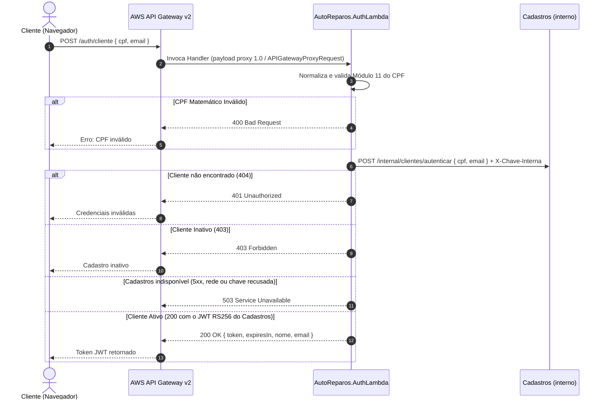

# AutoReparos - AuthLambda (Function Serverless)

> **Projeto:** AutoReparos - Sistema Integrado de Oficina Mecânica  
> **Componente:** Function Serverless de Autenticação de Clientes  
> **Fase:** Fase 3 Tech Challenge (13SOAT / 15SOAT FIAP)  
> **Stack:** C# .NET 10, AWS Lambda (`Amazon.Lambda.Core`, `Amazon.Lambda.APIGatewayEvents`), HttpClient para o Cadastros, leitura do JWT (`System.IdentityModel.Tokens.Jwt`)

---

## 1. Propósito e Arquitetura

O **AutoReparos.AuthLambda** é uma Function Serverless autônoma responsável pelo fluxo de autenticação de clientes externos sem atrito.
O cliente final não possui cadastro de login/senha no ASP.NET Identity (que é exclusivo para os operadores internos da oficina).

Ao acessar o portal do cliente, ele informa apenas **CPF** e **E-mail**. A Lambda:
1. Higieniza e valida matematicamente o CPF através do algoritmo Módulo 11 da Receita Federal (rejeitando sequências de dígitos repetidos como `111.111.111-11`);
2. Chama o endpoint interno do **Cadastros** (`POST /internal/clientes/autenticar`, com o cabeçalho `X-Chave-Interna`), dono dos clientes. **A Lambda não acessa o banco** e **não assina tokens**;
3. O Cadastros valida a existência, o e-mail e o status ativo do cliente e devolve o cliente e um **JWT RS256** (com `kid`) contendo `sub` (ClienteId GUID), `cpf`, `email` e `role: "Cliente"`. Os serviços validam esse token pelo JWKS do Cadastros;
4. A Lambda repassa o token ao cliente com o tempo restante (`expiresIn`, lido do `exp` do JWT).



---

## 2. Estrutura do Projeto

```
AutoReparos.AuthLambda/
├── src/
│   └── AutoReparos.AuthLambda/
│       ├── Functions/
│       │   └── ClienteAuthFunction.cs           # Handler da AWS Lambda
│       ├── Services/
│       │   ├── ICpfValidationService.cs         # Validação de CPF
│       │   ├── CpfValidationService.cs
│       │   ├── ICadastrosClient.cs              # Contrato do endpoint interno do Cadastros
│       │   └── CadastrosClient.cs               # HttpClient com X-Chave-Interna
│       └── Models/
│           ├── ClienteAuthRequest.cs            # DTO de entrada { cpf, email }
│           └── ClienteAuthResponse.cs           # DTO de saída { token, expiresIn, nome, email }
├── tests/
│   └── AutoReparos.AuthLambda.Tests/            # Suíte de testes unitários com xUnit & NSubstitute
│       ├── Functions/
│       │   └── ClienteAuthFunctionTests.cs      # Testes de status HTTP (200, 400, 401, 403, 500, 503)
│       └── Services/
│           ├── CpfValidationServiceTests.cs      # Casos de borda de CPF e sequências
│           └── CadastrosClientTests.cs          # Chamada interna, cabeçalho, status e falhas
├── .github/workflows/ci.yml                     # Pipeline CI/CD GitHub Actions
└── AutoReparos.AuthLambda.slnx                  # Solution .NET 10 autônoma
```

---

## 3. Variáveis de Ambiente Necessárias

| Variável | Descrição | Exemplo |
| :--- | :--- | :--- |
| `Cadastros__BaseUrl` | URL interna do Cadastros (alcançável só de dentro da rede) | `http://cadastros.autoreparos.svc.cluster.local` |
| `Cadastros__ChaveInterna` | Segredo de `X-Chave-Interna`, o mesmo Secret do K8s do Cadastros | (segredo) |

A Lambda não tem mais string de conexão com o banco nem segredo de assinatura de JWT: o security group do RDS não precisa liberar a Lambda.

---

## 4. Ambiente de Testes Local com Docker Compose

O `docker-compose.yml` sobe a Lambda apontando para um Cadastros em execução (por padrão `http://host.docker.internal:8080`; defina `CHAVE_INTERNA` com o mesmo segredo do Cadastros):

```bash
# Construir a imagem Docker da Lambda (.NET 10)
docker build -t autoreparos-auth-lambda .
```

---

## 5. Como Executar os Testes Localmente

```bash
# Restaurar dependências e compilar
dotnet build AutoReparos.AuthLambda.slnx

# Executar suíte de testes unitários com cobertura
dotnet test AutoReparos.AuthLambda.slnx
```

---

## 5. Exemplo de Chamada da API

```bash
curl -X POST https://<api-gateway-id>.execute-api.us-east-1.amazonaws.com/auth/cliente \
  -H "Content-Type: application/json" \
  -d '{
    "cpf": "12345678909",
    "email": "cliente@email.com"
  }'
```

**Resposta de Sucesso (200 OK):**
```json
{
  "token": "eyJhbGciOiJIUzI1NiIsInR5cCI6IkpXVCJ9...",
  "expiresIn": 3600,
  "nome": "Cliente Exemplo",
  "email": "cliente@email.com",
  "role": "Cliente"
}
```
